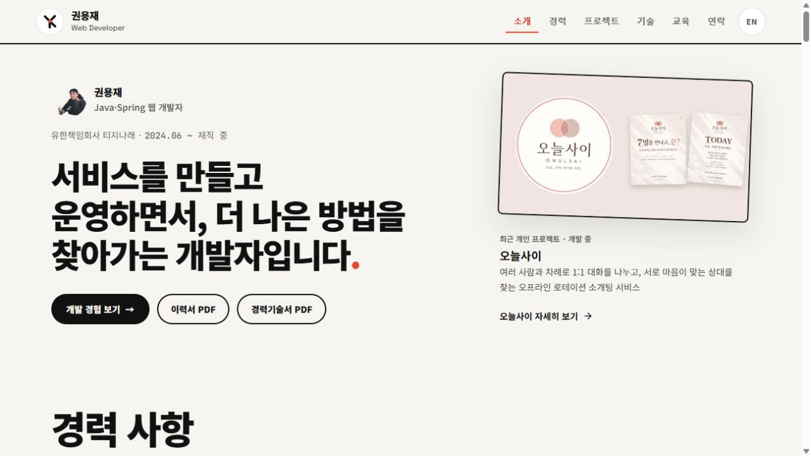

# 권용재 · 웹 개발자 포트폴리오

운영 중인 공공 · B2B 업무 시스템을 만드는 웹 개발자 권용재의 포트폴리오 사이트입니다. Vue 3와 TypeScript로 만들었습니다.

**[사이트 열기 ↗](https://www.yongjaekwon.com/)** · [포트폴리오 PDF](https://www.yongjaekwon.com/portfolio.pdf) · [이력서](https://www.yongjaekwon.com/resume.pdf) · [경력기술서](https://www.yongjaekwon.com/career.pdf)

[](https://www.yongjaekwon.com/)

## 대표 성과

| 성과 | 프로젝트 |
| --- | --- |
| A/S 월별 결과 조회 **약 53초 → 1.2초** (운영 DB 비교) | 교육용 단말 운영 시스템(TSMS) |
| 첨부파일 **300~400건** 압축을 진행 상태가 보이는 작업으로 바꿈 | B2B 협력사 포털(PPS) |
| 점검 결과를 보존하며 일련번호 기준 수정·중복 데이터 정리 | 교육용 단말 운영 시스템(TSMS) |

## 둘러보기

전체 · 프론트엔드 · 백엔드 중 하나를 고르면 그 영역에서 맡은 일 위주로 보입니다. 프로젝트를 열면 직접 맡은 기능과 문제 해결 과정을 볼 수 있습니다.

- **[TSMS · 단말 운영 시스템](docs/case-studies/tsms.md)**: A/S·학교별 조회 SQL, 점검·재방문 전산화, 운영 데이터 정리와 중복 요청 제어입니다. 학교별 조회 SQL은 운영 반영 전입니다.
- **[PPS · 협력사 포털](docs/case-studies/pps.md)**: 비동기 다운로드, 첨부파일 상태 오류, 인증번호 제한과 계정·알림·배포 업무입니다.
- **[SR30 · 서비스·자재 관리](docs/case-studies/sr30.md)**: 실적 집계, 전화번호 검색, 재고 조건, 접속 이력과 설치·철거 화면입니다.
- **[인터랙티브 데모](https://www.yongjaekwon.com/#projects)**: 예매, API 명세·테스트, 그림 영어 학습, 스터디룸 흐름을 샘플 데이터로 체험합니다. 외부 서버나 DB에 연결하지 않는 시뮬레이션입니다.

최종 국문 이력서와 경력기술서는 사진·디자인을 유지한 4쪽 PDF입니다. 영문 페이지에서도 국문 문서임을 표시해 같은 최신 파일을 제공합니다. 기존 영문 이력서 주소는 최신 이력서로 연결됩니다. [포트폴리오 PDF](https://www.yongjaekwon.com/portfolio.pdf)도 같은 내용으로 갱신했습니다.

## 프로젝트 원본

- **[오늘사이](https://github.com/YongjaeKwon/oneul-sai)**: 모집 회차·정원, 참가 신청·취소, 참가자·운영자 화면을 개발하고 있습니다. 마지막 자리의 동시 신청은 회원 조회를 대체한 로컬 테스트로 검증했습니다.
- **[티켓러시](https://github.com/YongjaeKwon/ticket-rush)**: 대기열, 좌석 선점, 모의 결제와 예약 흐름입니다. 동시 요청 수치는 MySQL·Redis를 이용한 로컬 테스트 결과입니다.
- **ReachRich**: 비공개 원본의 계좌·시세 수집, API 예외 처리, 전략 검증, 대시보드와 자동 작업을 소개합니다. 이미지는 합성 데이터로 구성한 화면 예시이며, 소스와 실제 계좌 데이터는 공개하지 않습니다.
- **[SSAFAST](https://github.com/SSAFAST/ssafast)**: 6인 팀 프로젝트에서 API 명세 폼, 테스트 요청 구성과 결과 화면을 맡았습니다.
- **[ddoing](https://github.com/GomGom-Team/ddoing)**: 그림 입력과 AI 추론 서버 연동, 학습 타이머·점수·경험치 화면을 맡았습니다. AI 모델 학습은 팀원이 담당했습니다.
- **[MODAC](https://github.com/YongjaeKwon/MODAC)**: 6인 팀에서 스터디룸·게시글·마이페이지 화면과 SockJS/STOMP 채팅 연동을 맡았습니다.

## 코드 살펴보기

소개 내용과 상세 사례는 [프로젝트 데이터](src/data/portfolio.ko.ts)와 [사례 데이터](src/data/caseStudies.ko.ts)에 따로 두고, 한국어 · 영어와 직무별 내용을 같은 화면 컴포넌트로 보여 줍니다. 영어 데이터는 영어 페이지를 열 때만 불러옵니다.

| 살펴볼 부분 | 코드 · 테스트 |
| --- | --- |
| 상세 모달을 닫을 때 포커스와 배경 상태 복원 | [모달](src/components/ProjectDetailModal.vue) · [테스트](tests/accessibilityContracts.test.ts) |
| 필요할 때 데모를 불러오고 종료 시 타이머 정리 | [데모 패널](src/components/demos/ProjectDemoPanel.vue) · [개별 구현](src/components/demos) · [테스트](tests/projectDemos.test.ts) |
| 연속 메뉴 이동 시 이전 예약 취소, 동작 줄이기 설정 존중 | [섹션 이동](src/utils/sectionNavigation.ts) · [테스트](tests/sectionNavigation.test.ts) |
| 스크롤 상태를 한 곳에서 계산해 메뉴와 버튼이 함께 사용 | [스크롤 상태](src/composables/useScrollMetrics.ts) · [계산](src/utils/scrollMetrics.ts) · [테스트](tests/scrollMetrics.test.ts) |
| 포트폴리오 PDF 생성 | [슬라이드 원본](docs/portfolio-deck.html) · [스크립트](scripts/generate-portfolio-pdf.mjs) · [Chrome 인쇄 공용 모듈](scripts/chrome-pdf.mjs) |

디자인 기준(색 · 글꼴 · 선 · 터치 규칙)은 [docs/ui-kit.md](docs/ui-kit.md)에 정리했습니다.

## 실행

Node.js 22 이상과 npm이 필요합니다.

```bash
npm ci
npm run dev
```

| 명령 | 하는 일 |
| --- | --- |
| `npm test` | 이 포트폴리오의 로직 · 접근성 · 콘텐츠 계약 검사 (다른 프로젝트나 전체 브라우저 흐름은 검증하지 않음) |
| `npm run build` | 타입 검사와 정적 빌드. `npm run preview`로 결과 확인 |
| `npm run portfolio:pdf` | `docs/portfolio-deck.html`을 `public/portfolio.pdf`로 인쇄 (Chrome 또는 Edge 필요) |
| `npm run resumes:pdf` | `docs/resume.html` · `docs/career.html`을 `public/resume.pdf` · `public/career.pdf`로 인쇄 |
